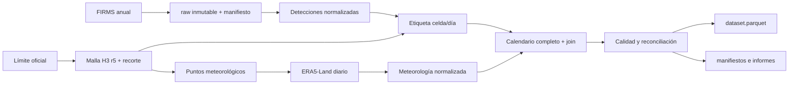

# Subplan 1: Data Engineering para Galicia VIIRS

Fecha: 2026-10-09

Estado: implementación en curso.

Rama: `feature/galicia-viirs-risk`

Plan padre: [GALICIA_RISK_PLAN.md](GALICIA_RISK_PLAN.md)

## 1. Resultado y límites

Construir localmente un dataset reproducible con una fila por celda H3
resolución 5 que interseque Galicia y día UTC. `label_detection` será 1 si el
archivo estándar de VIIRS S-NPP contiene al menos una detección aceptada en esa
celda y fecha, y 0 si no la contiene. Incluye actividad que continúa de días
anteriores; no representa inicio, superficie quemada ni confirmación de incendio.

Entregables: `dataset.parquet`, `grid.geojson`, originales e intermedios
trazables, `data_manifest.json` y `data_quality.json`. Esta tarea no entrena
modelos, modifica FastAPI, escribe en BigQuery ni despliega servicios.

## 2. Encaje con el proyecto existente

El sistema actual seguirá atendiendo el mapa reciente. `nasa_client.py` descarga
una ventana acotada, `fire_data_validation.py` la valida respecto a la hora
actual, `historical_ingest.py` produce snapshots horarios y React consume los
endpoints públicos. El histórico de entrenamiento tiene otras dependencias,
cadencia y retención, por lo que vivirá en `ml/` y no llamará a `fetch_fires()`.

Se mantendrán los conceptos canónicos actuales de UTC, coordenadas, confianza,
FRP e identidad determinista. No se importará directamente el validador de datos
recientes, porque debe rechazar fechas antiguas. Si aparece lógica pura
compartible, se extraerá a un módulo sin FastAPI ni configuración global y se
preservarán las pruebas del backend.



Cada etapa escribirá un artefacto nuevo de forma atómica. Las mismas entradas y
configuración deben producir las mismas filas, orden y hashes lógicos.

## 3. Estructura

```text
ml/
  README.md
  pyproject.toml
  requirements.in
  requirements.txt
  config/
    experiment.toml
    documented_outages.csv
  src/wildfire_risk/
    cli.py
    settings.py
    manifests.py
    firms_archive.py
    galicia_boundary.py
    h3_grid.py
    weather_archive.py
    labels.py
    dataset.py
    quality.py
  tests/
    fixtures/
    test_firms_archive.py
    test_h3_grid.py
    test_labels.py
    test_dataset.py
  data/
    raw/{firms,boundaries,weather}/
    interim/{detections,grid,weather_daily}/
    processed/
```

Decisiones:

- `ml/data/**` estará ignorado por Git salvo fixtures pequeños.
- Las dependencias de GeoPandas, H3 y PyArrow estarán separadas de
  `backend/requirements.txt`; Cloud Run no las necesita para servir el mapa.
- Fuentes, periodo, H3, variables y umbrales vivirán en `experiment.toml`.
- Los notebooks posteriores importarán el paquete y no duplicarán el pipeline.
- Los comandos aceptarán `--config`, `--data-dir` y `--offline`.

## 4. Contratos de entrada

### Límite de Galicia

Se fija el límite oficial NUTS 2024 ES11 de Eurostat/GISCO, región a escala
1:1M. La versión, URL, licencia, atribución y SHA-256 viven en
`ml/config/sources.toml`. Su uso es no comercial y requiere la atribución
`© EuroGeographics for the administrative boundaries`; un uso comercial
obligaría a revisar la licencia antes de publicar. Almacenamiento EPSG:4326 y
cálculos métricos EPSG:25829. La geometría debe ser válida, no vacía, cubrir
costa e islas y excluir territorios vecinos.

### FIRMS

Descargar el producto histórico estándar VIIRS S-NPP 375 m para 2018–2025
mediante la API de área FIRMS. Como la API admite como máximo cinco días, se
guardarán cortes deterministas de hasta cinco días y se consolidarán por año
después de validarlos. Las credenciales se leerán del entorno y nunca aparecerán
en TOML, argumentos, logs o manifiestos. Cada original se conservará sin
modificar con:

- producto/colección, año, URL sanitizada y hora UTC de descarga;
- estado HTTP, tamaño, SHA-256 y validación de esquema;
- conteos recibidos, aceptados, excluidos, duplicados y conflictos;
- estado `complete`, `failed` o `excluded` y motivo enumerable.

Se exigen `latitude`, `longitude`, `acq_date`, `acq_time`, `satellite`,
`confidence` y `frp`. Fechas y horas son UTC. Se comprobará que todas las filas
pertenecen a S-NPP. La etiqueta principal acepta confianza nominal y alta; baja,
desconocida o inválida se excluye y contabiliza. El umbral será configurable
para sensibilidad.

La identidad combina producto, satélite, instante UTC y coordenadas canónicas.
Duplicados se resuelven de forma determinista. `frp` solo sirve para auditoría y
no será característica del mismo día. El filtro final usa el polígono de Galicia,
incluyendo puntos de borde, no solo el rectángulo de descarga.

Un cero significa “sin detección aceptada en el archivo”, no “sin incendio”.
Nubes, horario orbital y sensibilidad del sensor limitan la etiqueta.

### Meteorología

Usar ERA5-Land explícito mediante Historical Weather de Open-Meteo con
`timezone=UTC`; no `best_match`. Variables diarias brutas:

- temperatura máxima a 2 m (°C);
- humedad relativa mínima y media a 2 m (%);
- viento máximo a 10 m (km/h);
- precipitación acumulada (mm).

Consultar coordenadas y años en lotes dentro de las cuotas vigentes. Cachear
cada respuesta por hash de petición y guardar modelo, unidades, coordenadas
solicitadas y devueltas. Es reanálisis para evaluación retrospectiva; no prueba
disponibilidad previa al día objetivo. La fase diaria deberá usar ejecuciones de
pronóstico con publicación comprobada.

## 5. Construcción espacial

El polyfill de H3 puede seleccionar por centro y omitir costa. Algoritmo:

1. Generar candidatos desde Galicia y añadir un anillo de vecinos al borde.
2. Convertirlos a polígonos, con orden longitud/latitud comprobado, y proyectar
   a EPSG:25829.
3. Conservar celdas cuya intersección tenga área positiva por encima de una
   tolerancia configurada.
4. Calcular `cell_area_km2`, `galicia_area_km2` y `galicia_fraction`.
5. Ordenar por el ID H3 completo y verificar unicidad y resolución 5.

`grid.geojson` conservará el hexágono completo; el intermedio guardará también
el recorte con Galicia. Para meteorología se usará `representative_point()` de
la intersección, calculado en EPSG:25829 y convertido a EPSG:4326. Así el punto
queda en la parte gallega de una celda costera. Si el proveedor resuelve varios
puntos al mismo nodo, compartirán `weather_point_id` y serie.

## 6. Tablas y dataset final

Intermedios:

- `detections.parquet`: identidad, instante UTC, fecha, punto, H3, satélite,
  confianza, FRP, hash de origen y flags.
- `grid.parquet`: H3, áreas, fracción, punto meteorológico, hashes y geometrías
  WKB completa/recortada con CRS en metadatos.
- `weather_daily.parquet`: punto, fecha, variables, modelo, unidades,
  coordenadas y flags.

Crear el producto cartesiano de celdas y días entre 2018-01-01 y 2025-12-31,
incluido el 29 de febrero. Agregar por clave:

- `label_detection`: 0/1 nullable;
- `detection_count`: entero no negativo;
- `label_status`: `available` o `excluded_source_period`.

Una descarga fallida o interrupción documentada conserva etiqueta nula. Un día
sin filas dentro de un CSV anual íntegro produce cero porque el objetivo es la
presencia en el archivo, con la limitación satelital ya descrita.

`dataset.parquet` tendrá:

- identidad: `h3_cell`, `target_date`, `year`, `split`, etiqueta y estado;
- espacio: áreas, fracción y punto meteorológico;
- meteorología diaria bruta;
- variables `_lag1` de D-1;
- lluvia D-7…D-1 y número de días válidos;
- seno/coseno estacional estable en años bisiestos.

`split` será `train` para 2018–2023, `validation` para 2024 y `test` para 2025.
Las columnas del propio día solo podrán alimentar la variante retrospectiva.

Metadatos: versiones de esquema/dataset, H3, periodo, hashes de configuración,
malla, FIRMS y meteorología, y versiones de Python/librerías. El timestamp de
construcción no entra en el hash lógico. Escribir a un temporal hermano,
validar, renombrar atómicamente, ordenar por `target_date,h3_cell` y comprimir
con Zstandard.

## 7. CLI

```powershell
python -m wildfire_risk.cli boundary fetch
python -m wildfire_risk.cli grid build
python -m wildfire_risk.cli firms fetch --start-year 2018 --end-year 2025
python -m wildfire_risk.cli firms normalize
python -m wildfire_risk.cli weather fetch
python -m wildfire_risk.cli dataset build
python -m wildfire_risk.cli dataset validate
```

Cada comando devolverá código no cero al fallar, no mostrará secretos ni
payloads, registrará solo conteos/hashes y podrá reanudarse sin descargar de
nuevo entradas válidas. `--offline` fallará si falta caché. Antes de ocho años,
se ejecutará todo con fixtures y una muestra pequeña real.

## 8. Validación y cierre

Pruebas con fixtures:

- UTC, tiempos inválidos, duplicados y conflictos;
- puntos interiores, exteriores y de borde;
- celdas interiores, costeras y con intersección diminuta;
- año bisiesto, D-7…D-1 y meteorología parcial;
- descargas fallidas nunca convertidas en negativos;
- orden/hash estables ante distinto orden de entrada.

Validaciones reales:

- clave única y todos los H3 de resolución 5 presentes en la malla;
- `detection_count > 0` si y solo si la etiqueta es 1;
- etiqueta nula solo en periodos excluidos;
- fechas y splits exactos;
- unidades/rangos meteorológicos conocidos;
- detecciones aceptadas reconciliadas antes y después de agregar;
- cardinalidad igual a celdas × días, explicando exclusiones;
- ningún secreto ni archivo bruto grande en Git.

La tarea termina cuando el dataset se regenera desde caché, pasan los controles
y quedan documentadas procedencia y limitaciones; escribir un Parquet por sí
solo no basta.

## 9. Decisiones

Cerradas:

- rama `feature/galicia-viirs-risk` y pipeline independiente en `ml/`;
- S-NPP estándar, 2018–2025, H3 r5, UTC;
- etiqueta nominal/alta, incluida persistencia;
- ERA5-Land para la demo y punto terrestre representativo por celda;
- almacenamiento local con manifiestos; 2025 reservado para test.

El piloto resolverá con evidencia: valores reales de satélite en los CSV,
disponibilidad de humedad, tolerancia de intersección, interrupciones
verificables y coste en tiempo/espacio/llamadas. Se registrará en
`experiment.toml`, `sources.toml`, manifiestos y el log de decisiones del
plan padre.

Primer corte implementado:

- [x] Configuración TOML con UTC, H3 r5, periodos, confianza y meteorología.
- [x] Carga validada de configuración y asignación temporal de splits.
- [x] Panel completo celda/día con ceros explícitos y periodos excluidos nulos.
- [x] Pruebas pequeñas para configuración, confianza, ceros, exclusión y
  detecciones duplicadas.
- [x] Normalización local y manifiesto reproducible de archivos FIRMS.
- [x] Cliente FIRMS por cortes de cinco días, caché validada y escritura atómica.
- [ ] Descarga autenticada y muestra real del archivo FIRMS.
- [x] Construcción H3 r5, recorte métrico y punto meteorológico terrestre.
- [x] Descarga y validación del límite oficial NUTS 2024 ES11 de Galicia.
- [ ] Meteorología, joins, Parquet e informe de calidad.

## 10. Puerta de despliegue

Este subplan solo autoriza trabajo local. No autoriza desplegar Cloud Run o
Firebase; crear/activar Jobs o Scheduler; crear buckets o subir a Cloud Storage;
escribir en BigQuery/Firestore; cambiar IAM, secretos o producción; ni activar
workflows de publicación.

En la fase operativa se prepararán primero cambios, configuración, pruebas,
coste y rollback. Después se pedirá autorización directa y específica al usuario
antes del primer cambio externo o despliegue.
