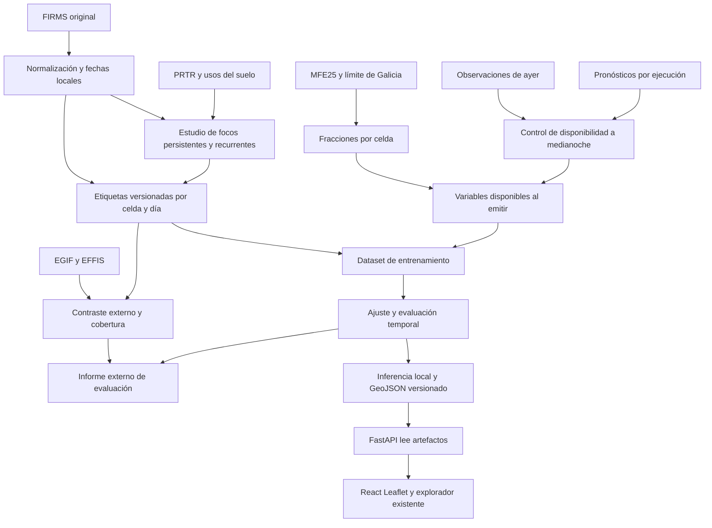

# Subplan: predicción diaria, contraste y contexto forestal

Actualizado: 2026-10-10.
Estado: diseño revisado; nuevos hitos sin implementar.
Rama: `feature/galicia-viirs-risk`.
Plan padre: [GALICIA_RISK_PLAN.md](GALICIA_RISK_PLAN.md).

## 1. Contrato confirmado y decisiones abiertas

Confirmado por el usuario el 2026-10-10:

- Priorizar exclusivamente el experimento con pronósticos, aunque haya menos
  años. La demostración histórica será una reconstrucción de predicciones;
  el reanálisis existente queda como recurso diagnóstico, no como entregable
  principal ni sustituto del pronóstico.
- Una probabilidad por celda H3 para cada día objetivo.
- Emitir a las 00:00 en `Europe/Madrid`, para el día que acaba de empezar.
  Ejemplo: emisión 10/10 a las 00:00; meteorología anterior del 09/10;
  pronóstico y etiqueta objetivo del 10/10.
- Incorporar meteorología del día anterior y previsión para el día objetivo.
- Añadir contraste con registros oficiales, estudio de focos persistentes o
  mensuales y contexto de montes/bosques.
- Evaluar EGIF, EFFIS, PRTR-España, MFE25 y MeteoGalicia + Open-Meteo antes
  de fijar versiones, proveedores y métodos.
- Admitir observaciones parciales de ayer con indicador de calidad si el método
  queda validado. El mínimo de cobertura se decidirá con evidencia, sin asumir
  que cualquier cantidad de datos permite emitir.
- Auditar focos industriales y comparar con/sin focos corroborados antes de
  decidir exclusiones definitivas.
- Persistencia: 15 días distintos con detección en una ventana móvil de 30 días, sin
  exigir continuidad. Esta precisión sustituye la formulación anterior >15 días.
- Recurrencia: actividad esporádica en cada uno de cuatro meses consecutivos;
  registrar presencia mensual sin exigir actividad diaria.
- Comparar radios de 500 y 1.000 metros y seleccionar uno para el experimento.
- Medir ambos radios desde un centro fijo por foco; no agrupar por cadenas de
  vecinos que puedan extenderse más allá del radio.
- Comparar toda Galicia con variables de bosque/matorral frente a un ámbito
  de celdas con suficiente bosque/matorral; en ambas variantes predecir cualquier
  detección de la celda. Elegir una opción tras evaluarlas; umbral aún pendiente.
- Mantener trabajo local y servicios gratuitos preferidos. Cualquier
  despliegue o escritura cloud exige la autorización directa ya acordada.

Decisiones registradas y aspectos pendientes; no se fijarán valores por defecto
silenciosos. D1–D4 ya tienen una dirección confirmada por el usuario:

| ID | Decisión | Pregunta o alternativas |
| --- | --- | --- |
| D1 | Persistencia | Confirmado: 15 días distintos con detección en una ventana móvil de 30 días. Contar fechas locales únicas; varias detecciones en un día cuentan como un solo día. |
| D2 | Recurrencia | Confirmado: actividad esporádica durante cuatro meses seguidos, con presencia en cada mes. No se ha fijado un máximo de frecuencia para «esporádica». |
| D3 | Misma zona | Confirmado: radio de 500 o 1.000 m desde un centro fijo por foco. Comparar y elegir uno con entrenamiento/validación. Proponer cómo fijar centros y resolver solapes antes de implementar. |
| D4 | Papel de vegetación | Confirmado: toda Galicia frente a celdas con suficiente bosque/matorral; en ambos casos cualquier detección en la celda es positiva. Acordar clases, denominador y umbral de cobertura tras inspeccionar MFE25. |
| D5 | Cobertura mínima para datos parciales | Emisión parcial autorizada condicionada a validación; acordar umbral y comportamiento bajo ese mínimo tras el piloto. |
| D6 | Exclusión industrial definitiva | Comparación con/sin focos corroborados autorizada; decidir política final con esa evidencia. |
| D7 | Fuentes definitivas y partición temporal | Elegir después del piloto de acceso, cobertura, licencias, latencia y procedencia del pronóstico. |

La etiqueta base sigue siendo cualquier detección VIIRS S-NPP nominal/alta,
incluidos incendios que continúan activos. No se ha autorizado sustituirla por
inicios confirmados. D4 cambia la población de celdas, no la definición del
positivo. D6 puede dar lugar a otra versión de etiqueta, que se acordará y
versionará para la comparación antes del entrenamiento.

## 2. Tiempo: qué podía saberse al emitir

Definir D como fecha local objetivo y E como su medianoche en Europe/Madrid.

- Observaciones anteriores: intervalo local [D-1 00:00, D 00:00).
- Pronóstico: intervalos válidos dentro de [D 00:00, D+1 00:00), procedentes
  de una ejecución disponible antes de E.
- Etiqueta FIRMS: convertir cada instante UTC a Europe/Madrid y agrupar por D.
- Guardar instantes en UTC y fechas objetivo con zona explícita. Un día local
  puede tener 23 o 25 horas; no exigir siempre 24 registros.
- Guardar `run_initialized_at`, `available_at` si está acreditado,
  `retrieved_at`, `valid_at`, `issued_at`, modelo y versión.
  El momento de descarga actual de un archivo no demuestra su disponibilidad
  histórica. Inicialización tampoco equivale a publicación.
- Agregar temperatura máxima, humedad mínima/media, viento máximo y lluvia
  de ayer; agregar las mismas magnitudes pronosticadas para D.
- La lluvia antecedente de siete días, si se conserva, cubre D-7…D-1.
  Exigir calendario completo, contar días válidos y expresar cobertura.

Riesgo a resolver en el piloto: a E la última observación de ayer o su resumen
pueden no estar publicados. No completar con reanálisis posterior ni atrasar
la emisión declarada. Guardar cobertura y latencia; consultar D5 si ocurre.
Un archivo de observaciones revisadas debe identificarse como tal, no como
prueba de lo disponible a medianoche.

Los resultados de reanálisis del código actual no satisfacen este contrato.
La muestra meteorológica de 2025 descargada anteriormente verificó el servicio,
no constituyó entrenamiento ni evaluación de modelos.

## 3. Fuentes específicas y acceso

Fuentes consultadas el 2026-10-10. Evaluación autorizada; elección definitiva
pendiente. Una página/documentación accesible no equivale a un dataset validado.

| Fuente | Papel propuesto | Acceso y limitación que comprobar |
| --- | --- | --- |
| [FIRMS Area API](https://firms.modaps.eosdis.nasa.gov/api/area/) | Etiqueta satelital S-NPP estándar | Cliente local existente; clave en entorno; disponibilidad por fecha, tipo de fuente si existe y huecos documentados. |
| [EGIF — MITECO](https://www.miteco.gob.es/es/biodiversidad/temas/incendios-forestales/estadisticas-datos.html) | Contraste administrativo principal | Buscador enlazado con exportación Excel/XML; datos consolidados por provincia. Auditar coordenadas, precisión, fechas y cobertura gallega; no garantizar 2025 completo. |
| [EFFIS Data and services](https://forest-fire.emergency.copernicus.eu/applications/data-and-services) | Perímetros y contraste complementario | Descargas actuales y solicitud para determinados históricos. No se enviará una solicitud en nombre del usuario sin su instrucción. Registrar sensores y cobertura: no es una referencia exhaustiva ni necesariamente independiente de VIIRS. |
| [PRTR-España, complejos industriales](https://ca.prtr-es.es/informes/facilitylevel.aspx) | Corroborar proximidad de instalaciones | Consulta/exportación por año, actividad y territorio. Verificar coordenadas y años efectivos; proximidad no confirma el origen del foco y ausencia no lo descarta. |
| [MFE25 Galicia — MITECO](https://www.miteco.gob.es/gl/cartografia-y-sig/ide/descargas/biodiversidad/mfe_galicia.html) | Cobertura forestal y matorral | SHP/GML descargables; ficha consultada indica actualización 31/12/2011. Revisar metadatos provinciales, fecha de referencia y diccionario antes de fijar versión. |
| [MFE25, definición](https://www.miteco.gob.es/es/cartografia-y-sig/ide/descargas/biodiversidad/mfe.html) | Interpretar clases y cobertura | Tipos de uso, cobertura y especies. Diferenciar bosque, otras superficies forestales y uso administrativo del término monte. |
| [CORINE Land Cover 2018](https://land.copernicus.eu/en/products/corine-land-cover/clc2018) | Alternativa/comprobación de usos del suelo | 44 clases, unidad mínima cartografiable de 25 ha. No sustituir MFE25 sin decisión; año de referencia y publicación se validarán por separado. |
| [MeteoGalicia, documentación JSON](https://www.meteogalicia.gal/datosred/infoweb/meteo/docs/rss/NovidadesJSON_es.pdf) | Candidato a observaciones de ayer | Documenta servicios de estaciones diarios/horarios; documento antiguo. Endpoint vigente, archivo histórico, calidad, licencias y latencia todavía sin verificar. |
| [Open-Meteo Single Runs](https://open-meteo.com/en/docs/single-runs-api) | Pronóstico identificado por ejecución | IFS HRES desde marzo de 2024; otros modelos desde abril de 2026 según documentación. La documentación describe parte de IFS como hindcasts: comprobar qué ejecuciones son operativas originales y cuáles reconstrucciones. |
| [Open-Meteo Previous Runs](https://open-meteo.com/en/docs/previous-runs-api) | Alternativa por anticipación fija | Auditar cobertura por modelo y equivalencia al corte local; un desfase nominal no demuestra disponibilidad a E. |
| [Open-Meteo Forecast](https://open-meteo.com/en/docs) | Captura futura de predicciones meteorológicas | Congelar respuesta, modelo y momento de captura; no consultar posteriormente el “último pronóstico” para reconstruir el pasado. |
| [Open-Meteo condiciones](https://open-meteo.com/en/terms) | Encaje gratuito y licencias | Validar cuotas y finalidad antes de lotes; atribución, caché y coste estimado en manifiesto. |

Evaluar solicitudes piloto, sin descargas masivas ni contratación. Guardar URL
de recurso exacto, versión, hash, CRS, licencia/atribución, fechas de cobertura,
campos disponibles, datos faltantes y fecha de comprobación en un registro.
Si EGIF no permite el contraste celda/día, publicar el nivel de agregación
posible y dejar ese criterio abierto, sin inventar precisión.

## 4. Arquitectura propuesta dentro de Wildfire

Reutilizar `ml/`, Parquet, manifiestos y la malla existente. Los nombres nuevos
de módulos y contratos siguientes son propuestas revisables en F0; no indican
código ya construido ni introducen otra plataforma.



La auditoría oficial evalúa etiquetas y resultados; sus perímetros finales,
duraciones finales y confirmaciones posteriores no son variables predictoras.
La flecha del estudio de focos hacia etiquetas requiere una política aprobada;
la versión bruta se conserva siempre.

| Módulo propuesto | Responsabilidad | Artefacto/clave |
| --- | --- | --- |
| `official_events.py` | Importar EGIF/EFFIS, precisión y cobertura | `official_events.parquet`: fuente + event_id; tiempos y geometría con precisión explícita |
| `thermal_sources.py` | Días únicos, rachas, recurrencia y revisión PRTR | `thermal_sites.parquet` y `site_evidence.parquet`: site_id, evidence_cutoff, rule_version |
| `land_cover.py` | Intersección métrica de clases con Galicia y H3 | `cell_land_cover.parquet`: celda + versión + vigencia |
| `weather_observations.py` | Calidad, cobertura y publicación de ayer | `weather_observations.parquet`: estación/punto + valid_at + revisión |
| `weather_forecasts.py` | Seleccionar una ejecución disponible antes de E | `forecast_runs.parquet`: modelo + run + punto + valid_at |
| `features.py` | Join por emisión y agregados temporales explícitos | `features.parquet`: celda + issued_at + target_date |
| `labels.py`, `dataset.py` existentes | Extender calendario/etiquetas y conservar originales | `label_detection_raw`, etiqueta del experimento, estado, versión; salida distinta del dataset UTC anterior |
| `validation.py` | Emparejar observaciones/eventos y evaluar modelos | `event_matches.parquet`, métricas y casos auditados |

Guardar separadamente `target_timezone`, `label_version`,
`feature_schema_version`, cobertura y hashes. Identificador del punto
meteorológico debe incluir proveedor, coordenadas efectivas y método;
no deduplicar estaciones o píxeles de modelos distintos por cercanía.

Propuesta de variables forestales: fracciones de arbolado, matorral, cultivo,
artificial y superficie no clasificada sobre la parte gallega de cada celda.
La suma y el denominador se validarán. Distancia a industria es evidencia para
auditoría; su inclusión predictiva requiere decisión. Antigüedad de cartografía
y cambios tras incendios deben evaluarse para evitar usar información futura.

## 5. Hitos específicos y criterios de cierre

Todos los hitos nuevos permanecen abiertos. Secuencia:
contrato inicial F0 → piloto F1 → contrato de comparaciones F0 → F2/F3/F4
→ F5 → selección y evaluación F6 → F7 → F8. F1 investiga cobertura sin
necesitar antes D7. F0 fija candidatos y criterios; la selección final de radio,
ámbito y política industrial se registra después de las comparaciones, antes
del test. El trabajo documental puede avanzar con preguntas abiertas.

### F0 — Fijar el experimento

- [x] Registrar las decisiones del usuario para D1–D4: días acumulados,
  cuatro meses, comparación 500/1.000 m y comparación de ámbitos forestales.
- [ ] Cerrar los detalles necesarios para ejecutar D1–D7, apoyados en el
  piloto; registrar candidatos y criterios sin exigir que una comparación
  tenga ganador antes de ejecutarla.
- [ ] Fijar el intervalo local del objetivo, etiqueta, política industrial y
  forestal, disponibilidad de ayer y modelo meteorológico candidato.
- [ ] Registrar qué periodos fueron inspeccionados y reservar test antes de
  explorar etiquetas, recurrencia o rendimiento en ellos.

Entrega: contrato versionado. Cierre: ningún parámetro que cambie el objetivo
o la población queda implícito; las alternativas por comparar están enumeradas
y el protocolo de elección está fijado, aunque todavía no exista un ganador.

### F1 — Piloto verificable de las fuentes

- [ ] Descargar muestra FIRMS autenticada; verificar estándar S-NPP y cobertura.
- [ ] Obtener muestra EGIF de Galicia y comprobar precisión espacial/temporal,
  cobertura por provincia/año y diccionario; probar acceso EFFIS complementario.
- [ ] Comprobar muestra PRTR, metadatos MFE25 y observaciones de MeteoGalicia.
- [ ] Comparar archivo meteorológico por ejecución con corte de medianoche,
  distinguiendo reanálisis, hindcast reconstruido y pronóstico operativo.
- [ ] Medir faltantes, retrasos, volumen y cuotas; presentar proveedor,
  versión, periodo y partición temporal candidatos al usuario.

Entrega: `source_audit.md` y `coverage_matrix.csv`.
Cierre: cada fuente obligatoria tiene muestra válida o limitación documentada;
no se promete backtest operativo si no puede reconstruirse la disponibilidad.

### F2 — Contraste con incendios oficiales

- [ ] Construir correspondencias espacio/tiempo por evento, con tolerancias
  justificadas y aprobadas. Un punto de inicio no es un perímetro completo.
- [ ] Distinguir coincidencia, sin coincidencia y no evaluable por precisión
  o cobertura. Ausencia en EGIF no demuestra ausencia de incendio.
- [ ] Si solo hay fecha de inicio, no inventar los días activos ni convertir
  toda la duración estimada en etiqueta diaria.
- [ ] Evaluar detecciones e incidencias por separado, evitando contar muchos
  píxeles del mismo incendio como confirmaciones independientes.
- [ ] Comparar por tamaño, provincia, época y cobertura del registro.

Entrega: tabla de correspondencias e informe de casos y sesgos.
Cierre: cada afirmación de confirmación tiene referencia y precisión; EFFIS
no se presenta como validación completamente independiente de FIRMS.

### F3 — Estudio de actividad térmica persistente o mensual

- [ ] Comparar sitios con centro fijo y radios de 500 y 1.000 m antes de
  agregar a H3 r5; medir fusiones de focos distintos, fragmentación y
  corroboración externa. Elegir un solo radio sin consultar el test reservado.
  No unir toda una celda por compartir ID.
- [ ] Medir días únicos, duración entre extremos, racha consecutiva,
  meses con detección, huecos y dispersión espacial; no confundir métricas.
- [ ] Evaluar por separado 15 días distintos en una ventana móvil de 30 días y actividad
  esporádica presente en cuatro meses consecutivos, según D1/D2; deduplicar
  detecciones del mismo día. Distribución día/noche y FRP sirven de auditoría.
- [ ] Contrastar candidatos con PRTR, uso del suelo y eventos EGIF/EFFIS;
  persistencia también puede corresponder a incendios prolongados,
  rescoldos o quemas vegetales repetidas.
- [ ] Proponer estados `unclassified`, `persistent_candidate`,
  `recurrent_candidate`, `industrial_supported`, `vegetation_supported`,
  `uncertain`; conservar evidencia y origen, sin declarar causalidad automática.
- [ ] Comparar etiqueta bruta y política de exclusión aprobada, contando
  positivos retirados y posibles incendios forestales descartados.
- [ ] Para uso predictivo calcular evidencias solo hasta E; revisar historial
  completo sirve para auditoría posterior, nunca para limpiar el pasado
  utilizando futuras detecciones del test. Fijar reglas con entrenamiento.

Entrega: catálogo de sitios, mapa de revisión e informe de sensibilidad.
Cierre: exclusiones justificadas, reversibles y versionadas; casos ambiguos
visibles y política acordada. Un foco industrial no excluye una celda completa.

### F4 — Variables forestales y meteorología disponible al emitir

- [ ] Preparar las dos opciones aprobadas en D4: toda Galicia con variables
  forestales y celdas que superen una cobertura de bosque/matorral acordada.
  Conservar cualquier detección como positivo en ambas. Acordar clases,
  denominador, umbral, versión forestal y método de muestreo meteorológico.
- [ ] Calcular fracciones forestales, matorral y restantes usos; comprobar
  costa, solapes, zonas sin cartografía y antigüedad.
- [ ] Agregar ayer y previsión del día objetivo separadamente, con sus
  unidades, cobertura horaria, procedencia y disponibilidad a E.
- [ ] Implementar D5; verificar días de 23/25 horas, final de mes/año,
  publicación retrasada, estación distante y pronóstico ausente.
- [ ] No sustituir huecos de previsión por tiempo realmente observado después.

Entrega: tablas espaciales y meteorológicas con informe temporal.
Cierre: ninguna entrada del modelo requiere conocer el futuro y todas las
celdas tienen cobertura medida, aunque no todas puedan emitir predicción.

### F5 — Dataset del experimento con pronósticos

- [ ] Elegir periodo y cortes tras F1 y confirmación del usuario; los cortes
  antiguos 2018–2023/2024/2025 no se heredan automáticamente.
- [ ] Integrar fuentes, etiqueta aprobada y variables por emisión.
- [ ] Actualizar esquema, claves, caché por petición completa y manifiestos.
- [ ] Verificar calendario completo, días ausentes, warm-up de antecedentes,
  duplicados, reconciliación y reproducción desde caché.
- [ ] Fijar imputación en entrenamiento y bloquear variables contemporáneas
  observadas, FRP objetivo, confirmaciones posteriores y cartografía futura.

Entrega: dataset y ficha de procedencia reproducibles.
Cierre: pruebas de corte temporal y controles de calidad aprobados antes de ML.

### F6 — Modelos y evaluación reservada

- [ ] Comparar baseline estacional, regresión logística y XGBoost con las
  mismas filas; los dos modelos son candidatos, sin ganador predeterminado.
- [ ] Comparar ayer solo, pronóstico solo, combinación y combinación +
  vegetación, manteniendo la misma etiqueta para medir valor añadido.
- [ ] Evaluar sensibilidad al tratamiento industrial; si cambia la etiqueta,
  informar población y prevalencia en vez de comparar AP directamente.
- [ ] Comparar los dos ámbitos de D4 con los mismos cortes temporales;
  informar cobertura, población, prevalencia y rendimiento en el subconjunto
  común. Elegir un ámbito con validación y congelarlo antes del test; no elegir
  por AP bruta entre poblaciones distintas. Documentar también el radio elegido.
- [ ] Separar episodios largos entre bloques mediante una política temporal
  aprobada, sin usar el test para ajustar umbrales industriales o modelos.
- [ ] AP, Recall@Top10%, Brier/calibración, incertidumbre por bloques y
  desglose forestal/provincial; auditoría oficial separada por evento.
- [ ] Congelar pipeline antes del test y declarar cualquier limitación del
  archivo meteorológico que impida interpretar resultados como operativos.

Entrega: modelo, ficha, tabla reproducible y auditoría externa.
Cierre: resultados honestos aunque no mejoren el baseline; criterio de mejora
se fija antes de evaluar. Una probabilidad requiere calibración comprobada.

### F7 — Integración local con FastAPI y React

- [ ] Precalcular GeoJSON por objetivo/emisión/modelo; servir con módulos de
  riesgo previstos, sin importar ML al servidor público.
- [ ] Proponer contrato con `issued_at`, fecha/zona objetivo, tipo de etiqueta,
  cobertura, versión y estado; acordarlo antes de implementarlo.
- [ ] React Leaflet conserva detecciones actuales y añade la capa predictiva.
  Mostrar bosque/matorral y candidatos recurrentes en auditoría según alcance
  aprobado; explicar diferencia entre detección y confirmación oficial.
- [ ] Si faltan entradas, distinguir ausencia de predicción de riesgo cero.
  Mantener aislamiento del mapa actual y del histórico BigQuery.

Entrega: demo histórica de pronósticos reconstruidos y evaluación enlazada.
Cierre: una fecha visible corresponde a su emisión y artefacto exactos.

### F8 — Operación, al final y con autorización

- [ ] Preparar ejecución idempotente a medianoche Europe/Madrid y manejo DST.
- [ ] Definir qué ocurre si la ejecución se retrasa: no incorporar datos
  posteriores a E manteniendo una falsa emisión de las 00:00.
- [ ] Verificar continuidad del instrumento y cobertura futura antes de
  automatizar; no mezclar satélites nuevos sin otra versión y validación.
- [ ] Preparar costes, configuración, publicación atómica y rollback.
- [ ] Pedir autorización directa para cada despliegue o cambio externo.

Entrega: propuesta operativa revisable; ejecución solo tras autorización.

## 6. Brechas del código actual y siguiente paso

Ya existen normalización FIRMS, malla, clientes, panel UTC y escritor Parquet.
Son piezas reutilizables; no completan F1–F7.

Trabajos requeridos: conversión de etiqueta al día local, disponibilidad a E,
pronósticos por ejecución, auditoría oficial, focos recurrentes, vegetación,
claves con emisión y versión, y pruebas de calendario continuo. Los lags actuales
por filas no bastan si hay huecos; el acumulado debe probar fechas exactas y
siete días previos, también al inicio de la partición.

Siguiente paso: realizar F1 con muestras pequeñas y concretar los detalles
pendientes del contrato. Las comparaciones de D3/D4 ya están autorizadas;
sus elecciones finales requieren evidencia de validación. No entrenar ni
descargar todo el archivo antes del contrato acordado.
Este documento cambia el plan, no la configuración ejecutable ni las etiquetas
existentes. No se han descargado aquí nuevos datasets ni contactado proveedores.

## 7. Arquitectura ejecutable y encaje con el código

Diseño propuesto para implementación incremental; los archivos nuevos de esta
sección todavía no existen. Se mantiene el paquete `ml/src/wildfire_risk` y el
entorno ML separado. Primero se completará una muestra reproducible de extremo
a extremo; después se ampliará al periodo elegido.

### 7.1 Límites y puntos de integración

| Capa | Base existente | Cambio previsto y límite |
| --- | --- | --- |
| Configuración | `ml/config/experiment.toml`, `sources.toml`, `settings.py` | Versionar contrato local, fuentes, cortes, candidatos y selección final; conservar identificable la configuración UTC anterior. No activar proveedores aún no auditados. |
| Ingesta | `firms_client.py`, `firms_archive.py`, `boundary_source.py`, `manifests.py` | Reutilizar transporte, validación y hashes. Añadir adaptadores de observaciones, pronósticos y archivos oficiales; cada fuente conserva su disponibilidad y revisión. |
| Geografía y etiquetas | `h3_grid.py`, `labels.py` | Conservar H3 r5; migrar fechas a Europe/Madrid y distinguir cero detecciones de archivo ausente. Añadir centros fijos y fracciones forestales sin cambiar el significado de H3. |
| Dataset | `dataset.py`, nuevo `features.py` | Separar variables disponibles al emitir de etiquetas posteriores. Reindexar calendarios antes de antecedentes; unir por celda, emisión y versión. |
| Experimento | Nuevos `train.py`, `evaluate.py`, `predict.py` | Una transformación compartida para entrenamiento e inferencia; modelos y preprocesamiento congelados. Notebooks solo para explorar y presentar resultados. |
| Ejecución local | Nuevo `cli.py` | Comandos por etapa y reanudación desde artefactos validados; sin servidor de tareas, base de datos adicional ni plataforma MLOps para la demo. |
| API | `backend/main.py`; nuevos `risk_models.py`, `risk_repository.py`, `risk_routes.py` | Leer artefactos; registrar ruta con protección existente. No entrenar ni llamar a FIRMS/meteorología durante una petición de riesgo. |
| Interfaz | `App.jsx`, `ControlDeck.jsx`, `FireMap.jsx`, `DataExplorer.jsx` | Añadir cliente `riskApi.js`, hook `useRiskData.js` y componente `RiskLayer.jsx`. Reutilizar mapa, controles y selección accesible. |

El `weather_client.py` actual obtiene reanálisis: se conserva como diagnóstico,
sin cambiarle silenciosamente el significado. La ingesta `/internal/ingest` y
BigQuery continúan siendo el histórico de observaciones de la aplicación;
no suministran por sí solos el histórico meteorológico ni las etiquetas del
experimento. Las rutas `/fires`, `/stats` y `/incidents` mantienen sus contratos.

### 7.2 Flujo y almacenamiento local

```text
ml/config/                  contrato y referencias de fuentes versionados
ml/data/raw/<fuente>/        respuestas originales + manifiesto de descarga
ml/data/processed/<version>/ malla, detecciones, sitios, clima y vegetación
ml/data/datasets/<id>/       filas por celda/emisión + etiquetas y particiones
ml/artifacts/<run_id>/       modelo, transformaciones, métricas y ficha
ml/artifacts/risk/<release>/ catálogo y GeoJSON que puede leer FastAPI
```

`ml/data/` y `ml/artifacts/` ya están ignorados en Git. Versionar en el repositorio
el protocolo, contratos, pruebas sintéticas y resúmenes pequeños; guardar junto
al artefacto los manifiestos de ejecución y hashes. No incorporar claves ni URLs
que las contengan a manifiestos o logs.

Cada etapa produce primero un temporal, valida esquema/conteos/hashes y publica
el resultado completo. Una interrupción conserva la versión anterior. La caché
se identifica por fuente, producto/modelo, región/puntos, variables, unidades,
periodo, ejecución meteorológica y versión de transformación; no basta con
identificar un archivo por fecha.

El `run_id` referencia commit, configuración, fuentes, versiones de dependencias
y semilla. Cambiar radio, máscara forestal o política industrial crea otro
experimento; los resultados previos permanecen trazables.

### 7.3 Contratos mínimos entre etapas

| Tabla/artefacto | Identidad y campos relevantes | Control de aceptación |
| --- | --- | --- |
| Detecciones | `detection_id`, instante UTC, fecha local, H3, confianza, fuente | Deduplicación y reconciliación con filas originales; no contar píxeles como incendios independientes. |
| Sitios | `site_id`, centro, radio, fecha de fijación, versión de regla | Toda asignación dentro del radio del centro fijo; solapes resueltos de forma determinista, sin usar posiciones futuras. |
| Evidencia temporal | Sitio, fecha de corte, días únicos en 30 días, presencia por mes, cobertura histórica | Varias detecciones del mismo día cuentan una vez; historial incompleto produce evidencia insuficiente, no ausencia demostrada. |
| Cobertura forestal | H3, versión cartográfica, superficie conocida, fracción bosque/matorral | Fracciones válidas, sin doble conteo; sin cartografía no equivale a no forestal. |
| Clima por emisión | Punto/celda, emisión, variable, tiempo válido, disponibilidad, modelo/run, cobertura | Entrada disponible al corte; variable/unidad y revisión explícitas; falta de pronóstico no se rellena con observaciones futuras. |
| Panel final | H3, emisión, fecha objetivo, versión, estado de etiqueta y elegibilidad | Una fila por clave; etiquetas faltantes separadas de cero; cobertura y exclusiones cuantificadas. |
| Predicción | H3, emisión, fecha objetivo, modelo, probabilidad, calidad, motivo de ausencia | Probabilidad finita entre 0 y 1 o nula con motivo; nunca convertir ausencia de datos en riesgo cero. |

Para una emisión al inicio de D, el ejemplo de ventana causal de persistencia
es D-30…D-1, contado por fechas locales y limitado además por disponibilidad.
Los cuatro meses consecutivos necesitan una historia suficiente y una convención
explícita sobre el mes parcial. Propuesta pendiente: usar cuatro meses naturales
cerrados para la versión disponible al emitir; la auditoría posterior puede
mostrar meses parciales, claramente identificados. No imponer un máximo de
actividad para «esporádica» sin acordarlo.

Dos vistas de sitios: evidencia disponible al emitir y auditoría retrospectiva.
Los hallazgos posteriores pueden explicar resultados, pero no modificar
silenciosamente las decisiones simuladas de fechas anteriores. Los centros se
fijan con información disponible entonces; la regla para crear nuevos centros
y desempatar solapes se propondrá antes de construir `thermal_sources.py`.

### 7.4 Servicio y demo: contrato propuesto

- `GET /api/v1/risk?date=YYYY-MM-DD`: conservar la ruta planteada; `date` es
  fecha objetivo en Europe/Madrid. El repositorio selecciona la versión publicada
  explícitamente en el catálogo, sin buscar arbitrariamente el último archivo.
- `GET /api/v1/risk/catalog`: propuesta de listado de fechas disponibles,
  versión y resumen de cobertura para que el selector no adivine fechas.
- `FeatureCollection` con metadatos `issued_at`, `generated_at`, `target_date`,
  `target_timezone`, modelo, etiqueta y versión. En la demo `issued_at` es el
  corte histórico simulado; `generated_at` es la generación real del artefacto.
  Mostrar que se trata de una reconstrucción, no de una emisión histórica real.
- Cada hexágono devuelve ID, probabilidad y estado/calidad; las celdas fuera
  del ámbito seleccionado se distinguen de las celdas elegibles sin datos.
- Propuesta de errores: 422 para fecha inválida, 404 para fecha no publicada,
  503 para artefacto publicado pero inaccesible/inválido. Nunca responder con
  otra fecha como si fuera la solicitada.
- Reutilizar cliente anónimo, App Check, rate limit y CORS del proyecto.
  Validar rutas mediante catálogo y fecha tipada; no aceptar paths del cliente.
  Dejar el contrato acordado antes de implementar rutas o caché nueva.

En `App.jsx`, separar fecha de riesgo de la ventana `days` de observaciones.
Cargar riesgo al seleccionar esa capa; cancelar respuestas antiguas al cambiar
fecha. La caché de riesgo incluye fecha y versión. `DataExplorer` ofrece las
mismas celdas y selección que el mapa; leyenda, calidad y texto explican qué se
predice. Una fecha histórica puede seguir disponible sin ser un dato «viejo»
por haber transcurrido dos horas: no reutilizar sin adaptación el TTL de incendios.

## 8. Fases de ejecución, pasos y puertas de salida

Estas fases descomponen F0–F8; no constituyen otra hoja de ruta independiente.
Cada paso se implementará con un cambio pequeño, sus pruebas necesarias y una
actualización de estado. Estimación de esfuerzo tras el piloto, sin prometer
que la cobertura de datos encaje en cuatro semanas.

| Fase y dependencia | Pasos concretos | Entrega y puerta de salida |
| --- | --- | --- |
| A. Viabilidad y protocolo — F0/F1 | A.1 inventariar configuración/código; A.2 pilotar pronósticos y observaciones al corte; A.3 comprobar FIRMS y muestras oficiales/cartográficas; A.4 presentar fuentes, años y limitaciones; A.5 reservar test y registrar criterios de elección. | Auditoría de fuentes y contrato inicial. No pasar al entrenamiento si no puede distinguirse pronóstico operativo de reconstrucción posterior. |
| B. Base reproducible — A, F5 parcial | B.1 versionar configuración local; B.2 normalizar tiempo/cobertura/manifiestos; B.3 preparar CLI por etapas; B.4 completar una muestra FIRMS → etiqueta local → clima → Parquet. | Una ejecución pequeña repetible desde caché, con calendario y claves validados. Ningún modelo requerido todavía. |
| C. Auditoría y territorio — B, F2/F3/F4 | C.1 importar eventos y cobertura; C.2 fijar protocolo de centros; C.3 generar candidatos 500/1.000 m; C.4 calcular 15/30 días y cuatro meses; C.5 corroborar PRTR/eventos; C.6 intersectar MFE25; C.7 proponer umbral forestal y producir ambas poblaciones. | Catálogos de evidencia, fracciones y reporte comparativo; sin exclusiones automáticas ni eliminación de una celda por un foco industrial. |
| D. Dataset del experimento — A/B/C, F4/F5 | D.1 construir clima observado/pronosticado por emisión; D.2 validar política de datos parciales; D.3 ensamblar variantes aprobadas; D.4 congelar esquemas y particiones; D.5 ampliar al periodo acordado y auditar descartes. | Dataset versionado, cobertura y ficha; mismas reglas temporales y transformaciones para evaluación e inferencia. |
| E. Selección y evaluación — D, F6 | E.1 baseline estacional y logístico; E.2 comparar radios con evidencia espacial; E.3 comparar política industrial y ámbito; E.4 probar aporte de pronóstico/vegetación; E.5 comparar XGBoost; E.6 calibrar, congelar y abrir test una vez. | Un radio, un ámbito y una política final documentados, modelo y resultados reproducibles. Publicar también un resultado negativo frente al baseline. |
| F. Demo integrada local — E, F7 | F.1 exportar una fecha y catálogo; F.2 validar contrato en FastAPI; F.3 añadir capa/fecha/explorador; F.4 comprobar navegación, errores y aislamiento; F.5 ampliar catálogo y redactar ficha de demo. | Recorrido local desde fecha elegida hasta predicción, fuentes y evaluación. Sin despliegue. |
| G. Preparación operativa — F, F8 | G.1 ejecutar manualmente la inferencia diaria local; G.2 probar faltantes, retrasos y reejecución; G.3 preparar configuración, costes y rollback; G.4 pedir autorización directa; G.5 solo tras autorización desplegar y comprobar. | Propuesta concreta revisable antes de cualquier despliegue. Hasta la autorización, los pasos cloud permanecen pendientes. |

Ruta crítica: viabilidad del pronóstico → contrato → muestra temporal completa
→ dataset → evaluación → demo. Dentro de C se pueden preparar registros oficiales
y cartografía sin esperar al modelo; no implica crear agentes ni infraestructura
de ejecución paralela.

### 8.1 Protocolo de comparación sin explorar todas las combinaciones

1. Fijar antes del entrenamiento candidatos, criterios y presupuesto de pruebas.
   Usar los mismos cortes y registrar las fechas que ya se inspeccionaron.
2. Comparar los radios con corroboración y errores de agrupación; no escoger
   uno únicamente porque elimine más positivos o mejore la métrica del modelo.
3. Comparar política bruta frente a focos corroborados. Mantener un informe
   separado cuando cambie la etiqueta; nunca elegir por AP entre targets distintos.
4. Comparar toda Galicia frente a celdas forestales con la misma definición de
   positivo. Informar tanto el subconjunto común como la cobertura que se pierde.
   El umbral forestal se propone con cartografía y se acuerda antes de medir test.
5. Evaluar ayer/pronóstico/combinación/vegetación con una población y etiqueta
   fijas. Ajustar imputación, hiperparámetros y calibración sin acceder al test.
6. Separar bloques de ajuste, selección y calibración dentro del periodo de
   desarrollo; si faltan años, proponer validación temporal por bloques y declarar
   la incertidumbre. No usar el mismo bloque para calibrar y declarar rendimiento
   final sin una evaluación posterior reservada.
7. Definir Recall@Top10% por día: seleccionar el 10% de celdas elegibles, fijar
   redondeo/desempates y tratamiento de días sin positivos. Publicar AP, Brier,
   cobertura y métricas por bloques; no cambiar denominadores sin indicarlo.

### 8.2 Comprobaciones que desbloquean cada entrega

| Área | Casos mínimos que deben demostrar comportamiento |
| --- | --- |
| Calendario y causalidad | Conversión UTC/local, 23/25 horas, hueco de un día, frontera de 30 días, run publicado después del corte, observaciones revisadas. |
| Sitios | Duplicados intradía, 14/15 días, actividad en 3/4 meses, dos focos próximos, cadena de vecinos, detección fuera del radio, centro que no cambia con datos futuros. |
| Cobertura y etiquetas | Archivo ausente frente a cero detecciones; mismo positivo en población general/forestal; celdas mixtas y superficie desconocida; exclusión reversible por detección. |
| Dataset y modelo | Uniones sin multiplicar filas, antecedentes exactos, particiones separadas, imputación ajustada solo en train, misma transformación en inferencia, probabilidades válidas. |
| API y frontend | Fecha inválida/ausente, artefacto corrupto, protección de rutas, cambio rápido de fecha, riesgo nulo frente a cero, selección por teclado y mapa actual funcional. |
| Reproducción | Reejecución sin consumir red cuando la caché es válida; interrupción sin publicar artefactos parciales; manifiestos sin secretos y resultados trazables. |

Aplicar `TESTING.md`: pruebas específicas al subsistema modificado; no ejecutar
la suite completa por cambios documentales. Las pruebas automatizadas no consumen
cuota NASA ni escriben en cloud. Los pilotos reales son ejecuciones separadas.

### 8.3 Próximas entregas, por orden

- [ ] A.1/A.2: auditar capacidad del archivo meteorológico para reconstruir el
  corte de medianoche y cobertura de observaciones, con muestras pequeñas.
- [ ] A.3/A.4: presentar matriz de fuentes, fechas comunes y limitaciones;
  proponer proveedor y partición temporal para decisión del usuario.
- [ ] C.2/C.6, preparación de contrato: presentar regla de centros/solapes,
  interpretación del mes parcial y candidatos de cobertura forestal basados
  en datos, sin exigir al usuario elegir umbrales arbitrarios ahora.
- [ ] B.1/B.4: implementar la primera muestra completa con contrato aprobado;
  mantener todos los hitos posteriores abiertos hasta su verificación.
