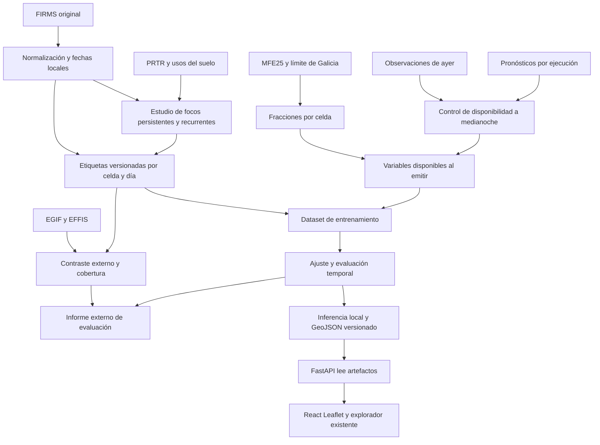

# Subplan: predicción diaria, contraste y contexto forestal

Actualizado: 2026-10-10.
Estado: diseño revisado; nuevos hitos sin implementar.
Rama: `feature/galicia-viirs-risk`.
Plan padre: [GALICIA_RISK_PLAN.md](GALICIA_RISK_PLAN.md).

## 1. Contrato confirmado y decisiones abiertas

Confirmado por el usuario el 2026-10-10:

- Priorizar exclusivamente el experimento con pronósticos, aunque haya menos
  años. La demostración histórica será una reconstrucción de predicciones;
  el reanálisis existente queda como recurso diagnóstico, no como entregable
  principal ni sustituto del pronóstico.
- Una probabilidad por celda H3 para cada día objetivo.
- Emitir a las 00:00 en `Europe/Madrid`, para el día que acaba de empezar.
  Ejemplo: emisión 10/10 a las 00:00; meteorología anterior del 09/10;
  pronóstico y etiqueta objetivo del 10/10.
- Incorporar meteorología del día anterior y previsión para el día objetivo.
- Añadir contraste con registros oficiales, estudio de focos persistentes o
  mensuales y contexto de montes/bosques.
- Evaluar EGIF, EFFIS, PRTR-España, MFE25 y MeteoGalicia + Open-Meteo antes
  de fijar versiones, proveedores y métodos.
- Admitir observaciones parciales de ayer con indicador de calidad si el método
  queda validado. El mínimo de cobertura se decidirá con evidencia, sin asumir
  que cualquier cantidad de datos permite emitir.
- Auditar focos industriales y comparar con/sin focos corroborados antes de
  decidir exclusiones definitivas.
- Mantener trabajo local y servicios gratuitos preferidos. Cualquier
  despliegue o escritura cloud exige la autorización directa ya acordada.

Pendiente de respuesta; no se fijarán valores por defecto silenciosos:

| ID | Decisión | Pregunta o alternativas |
| --- | --- | --- |
| D1 | Persistencia | ¿Más de 15 días consecutivos, días con detección acumulados o duración entre primera y última detección? |
| D2 | Recurrencia | ¿Al menos una detección en cada mes durante cuántos meses y con qué continuidad? |
| D3 | Misma zona | Radio métrico o resolución espacial fina; ofrecer comparación 375/750/1.000 m como ensayo, no parámetros aprobados. |
| D4 | Papel de vegetación | Toda Galicia con fracciones forestales como variables, objetivo restringido a terreno forestal/matorral, o comparación de ambos. |
| D5 | Cobertura mínima para datos parciales | Emisión parcial autorizada condicionada a validación; acordar umbral y comportamiento bajo ese mínimo tras el piloto. |
| D6 | Exclusión industrial definitiva | Comparación con/sin focos corroborados autorizada; decidir política final con esa evidencia. |
| D7 | Fuentes definitivas y partición temporal | Elegir después del piloto de acceso, cobertura, licencias, latencia y procedencia del pronóstico. |

La etiqueta base sigue siendo cualquier detección VIIRS S-NPP nominal/alta,
incluidos incendios que continúan activos. No se ha autorizado sustituirla por
inicios confirmados. D4 y D6 pueden dar lugar a otra versión de etiqueta, que se
aprobará y versionará antes del entrenamiento.

## 2. Tiempo: qué podía saberse al emitir

Definir D como fecha local objetivo y E como su medianoche en Europe/Madrid.

- Observaciones anteriores: intervalo local [D-1 00:00, D 00:00).
- Pronóstico: intervalos válidos dentro de [D 00:00, D+1 00:00), procedentes
  de una ejecución disponible antes de E.
- Etiqueta FIRMS: convertir cada instante UTC a Europe/Madrid y agrupar por D.
- Guardar instantes en UTC y fechas objetivo con zona explícita. Un día local
  puede tener 23 o 25 horas; no exigir siempre 24 registros.
- Guardar `run_initialized_at`, `available_at` si está acreditado,
  `retrieved_at`, `valid_at`, `issued_at`, modelo y versión.
  El momento de descarga actual de un archivo no demuestra su disponibilidad
  histórica. Inicialización tampoco equivale a publicación.
- Agregar temperatura máxima, humedad mínima/media, viento máximo y lluvia
  de ayer; agregar las mismas magnitudes pronosticadas para D.
- La lluvia antecedente de siete días, si se conserva, cubre D-7…D-1.
  Exigir calendario completo, contar días válidos y expresar cobertura.

Riesgo a resolver en el piloto: a E la última observación de ayer o su resumen
pueden no estar publicados. No completar con reanálisis posterior ni atrasar
la emisión declarada. Guardar cobertura y latencia; consultar D5 si ocurre.
Un archivo de observaciones revisadas debe identificarse como tal, no como
prueba de lo disponible a medianoche.

Los resultados de reanálisis del código actual no satisfacen este contrato.
La muestra meteorológica de 2025 descargada anteriormente verificó el servicio,
no constituyó entrenamiento ni evaluación de modelos.

## 3. Fuentes específicas y acceso

Fuentes consultadas el 2026-10-10. Evaluación autorizada; elección definitiva
pendiente. Una página/documentación accesible no equivale a un dataset validado.

| Fuente | Papel propuesto | Acceso y limitación que comprobar |
| --- | --- | --- |
| [FIRMS Area API](https://firms.modaps.eosdis.nasa.gov/api/area/) | Etiqueta satelital S-NPP estándar | Cliente local existente; clave en entorno; disponibilidad por fecha, tipo de fuente si existe y huecos documentados. |
| [EGIF — MITECO](https://www.miteco.gob.es/es/biodiversidad/temas/incendios-forestales/estadisticas-datos.html) | Contraste administrativo principal | Buscador enlazado con exportación Excel/XML; datos consolidados por provincia. Auditar coordenadas, precisión, fechas y cobertura gallega; no garantizar 2025 completo. |
| [EFFIS Data and services](https://forest-fire.emergency.copernicus.eu/applications/data-and-services) | Perímetros y contraste complementario | Descargas actuales y solicitud para determinados históricos. No se enviará una solicitud en nombre del usuario sin su instrucción. Registrar sensores y cobertura: no es una referencia exhaustiva ni necesariamente independiente de VIIRS. |
| [PRTR-España, complejos industriales](https://ca.prtr-es.es/informes/facilitylevel.aspx) | Corroborar proximidad de instalaciones | Consulta/exportación por año, actividad y territorio. Verificar coordenadas y años efectivos; proximidad no confirma el origen del foco y ausencia no lo descarta. |
| [MFE25 Galicia — MITECO](https://www.miteco.gob.es/gl/cartografia-y-sig/ide/descargas/biodiversidad/mfe_galicia.html) | Cobertura forestal y matorral | SHP/GML descargables; ficha consultada indica actualización 31/12/2011. Revisar metadatos provinciales, fecha de referencia y diccionario antes de fijar versión. |
| [MFE25, definición](https://www.miteco.gob.es/es/cartografia-y-sig/ide/descargas/biodiversidad/mfe.html) | Interpretar clases y cobertura | Tipos de uso, cobertura y especies. Diferenciar bosque, otras superficies forestales y uso administrativo del término monte. |
| [CORINE Land Cover 2018](https://land.copernicus.eu/en/products/corine-land-cover/clc2018) | Alternativa/comprobación de usos del suelo | 44 clases, unidad mínima cartografiable de 25 ha. No sustituir MFE25 sin decisión; año de referencia y publicación se validarán por separado. |
| [MeteoGalicia, documentación JSON](https://www.meteogalicia.gal/datosred/infoweb/meteo/docs/rss/NovidadesJSON_es.pdf) | Candidato a observaciones de ayer | Documenta servicios de estaciones diarios/horarios; documento antiguo. Endpoint vigente, archivo histórico, calidad, licencias y latencia todavía sin verificar. |
| [Open-Meteo Single Runs](https://open-meteo.com/en/docs/single-runs-api) | Pronóstico identificado por ejecución | IFS HRES desde marzo de 2024; otros modelos desde abril de 2026 según documentación. La documentación describe parte de IFS como hindcasts: comprobar qué ejecuciones son operativas originales y cuáles reconstrucciones. |
| [Open-Meteo Previous Runs](https://open-meteo.com/en/docs/previous-runs-api) | Alternativa por anticipación fija | Auditar cobertura por modelo y equivalencia al corte local; un desfase nominal no demuestra disponibilidad a E. |
| [Open-Meteo Forecast](https://open-meteo.com/en/docs) | Captura futura de predicciones meteorológicas | Congelar respuesta, modelo y momento de captura; no consultar posteriormente el “último pronóstico” para reconstruir el pasado. |
| [Open-Meteo condiciones](https://open-meteo.com/en/terms) | Encaje gratuito y licencias | Validar cuotas y finalidad antes de lotes; atribución, caché y coste estimado en manifiesto. |

Evaluar solicitudes piloto, sin descargas masivas ni contratación. Guardar URL
de recurso exacto, versión, hash, CRS, licencia/atribución, fechas de cobertura,
campos disponibles, datos faltantes y fecha de comprobación en un registro.
Si EGIF no permite el contraste celda/día, publicar el nivel de agregación
posible y dejar ese criterio abierto, sin inventar precisión.

## 4. Arquitectura propuesta dentro de Wildfire

Reutilizar `ml/`, Parquet, manifiestos y la malla existente. Los nombres nuevos
de módulos y contratos siguientes son propuestas revisables en F0; no indican
código ya construido ni introducen otra plataforma.

La auditoría oficial evalúa etiquetas y resultados; sus perímetros finales,
duraciones finales y confirmaciones posteriores no son variables predictoras.
La flecha del estudio de focos hacia etiquetas requiere una política aprobada;
la versión bruta se conserva siempre.

| Módulo propuesto | Responsabilidad | Artefacto/clave |
| --- | --- | --- |
| `official_events.py` | Importar EGIF/EFFIS, precisión y cobertura | `official_events.parquet`: fuente + event_id; tiempos y geometría con precisión explícita |
| `thermal_sources.py` | Días únicos, rachas, recurrencia y revisión PRTR | `thermal_sites.parquet` y `site_evidence.parquet`: site_id, evidence_cutoff, rule_version |
| `land_cover.py` | Intersección métrica de clases con Galicia y H3 | `cell_land_cover.parquet`: celda + versión + vigencia |
| `weather_observations.py` | Calidad, cobertura y publicación de ayer | `weather_observations.parquet`: estación/punto + valid_at + revisión |
| `weather_forecasts.py` | Seleccionar una ejecución disponible antes de E | `forecast_runs.parquet`: modelo + run + punto + valid_at |
| `features.py` | Join por emisión y agregados temporales explícitos | `features.parquet`: celda + issued_at + target_date |
| `labels.py`, `dataset.py` existentes | Extender calendario/etiquetas y conservar originales | `label_detection_raw`, etiqueta del experimento, estado, versión; salida distinta del dataset UTC anterior |
| `validation.py` | Emparejar observaciones/eventos y evaluar modelos | `event_matches.parquet`, métricas y casos auditados |

Guardar separadamente `target_timezone`, `label_version`,
`feature_schema_version`, cobertura y hashes. Identificador del punto
meteorológico debe incluir proveedor, coordenadas efectivas y método;
no deduplicar estaciones o píxeles de modelos distintos por cercanía.

Propuesta de variables forestales: fracciones de arbolado, matorral, cultivo,
artificial y superficie no clasificada sobre la parte gallega de cada celda.
La suma y el denominador se validarán. Distancia a industria es evidencia para
auditoría; su inclusión predictiva requiere decisión. Antigüedad de cartografía
y cambios tras incendios deben evaluarse para evitar usar información futura.

## 5. Hitos específicos y criterios de cierre

Todos los hitos nuevos permanecen abiertos. Secuencia:
contrato inicial F0 → piloto F1 → cierre de decisiones F0 → F2/F3/F4
→ F5 → F6 → F7 → F8. F1 puede investigar cobertura sin cerrar antes D7.
El trabajo documental puede avanzar mientras quedan preguntas abiertas.

### F0 — Fijar el experimento

- [ ] Resolver D1–D7 con el usuario; registrar decisiones y alternativas.
- [ ] Fijar el intervalo local del objetivo, etiqueta, política industrial y
  forestal, disponibilidad de ayer y modelo meteorológico candidato.
- [ ] Registrar qué periodos fueron inspeccionados y reservar test antes de
  explorar etiquetas, recurrencia o rendimiento en ellos.

Entrega: contrato versionado. Cierre: ningún parámetro que cambie el objetivo
o la población de evaluación queda implícito.

### F1 — Piloto verificable de las fuentes

- [ ] Descargar muestra FIRMS autenticada; verificar estándar S-NPP y cobertura.
- [ ] Obtener muestra EGIF de Galicia y comprobar precisión espacial/temporal,
  cobertura por provincia/año y diccionario; probar acceso EFFIS complementario.
- [ ] Comprobar muestra PRTR, metadatos MFE25 y observaciones de MeteoGalicia.
- [ ] Comparar archivo meteorológico por ejecución con corte de medianoche,
  distinguiendo reanálisis, hindcast reconstruido y pronóstico operativo.
- [ ] Medir faltantes, retrasos, volumen y cuotas; presentar proveedor,
  versión, periodo y partición temporal candidatos al usuario.

Entrega: `source_audit.md` y `coverage_matrix.csv`.
Cierre: cada fuente obligatoria tiene muestra válida o limitación documentada;
no se promete backtest operativo si no puede reconstruirse la disponibilidad.

### F2 — Contraste con incendios oficiales

- [ ] Construir correspondencias espacio/tiempo por evento, con tolerancias
  justificadas y aprobadas. Un punto de inicio no es un perímetro completo.
- [ ] Distinguir coincidencia, sin coincidencia y no evaluable por precisión
  o cobertura. Ausencia en EGIF no demuestra ausencia de incendio.
- [ ] Si solo hay fecha de inicio, no inventar los días activos ni convertir
  toda la duración estimada en etiqueta diaria.
- [ ] Evaluar detecciones e incidencias por separado, evitando contar muchos
  píxeles del mismo incendio como confirmaciones independientes.
- [ ] Comparar por tamaño, provincia, época y cobertura del registro.

Entrega: tabla de correspondencias e informe de casos y sesgos.
Cierre: cada afirmación de confirmación tiene referencia y precisión; EFFIS
no se presenta como validación completamente independiente de FIRMS.

### F3 — Estudio de actividad térmica persistente o mensual

- [ ] Agrupar detecciones en sitios con escala fina aprobada en D3 antes de
  agregarlas a H3 r5. No unir toda una celda por compartir ID.
- [ ] Medir días únicos, duración entre extremos, racha consecutiva,
  meses con detección, huecos y dispersión espacial; no confundir métricas.
- [ ] Evaluar por separado las hipótesis >15 días y recurrencia mensual
  definidas en D1/D2, junto con distribución día/noche y FRP como auditoría.
- [ ] Contrastar candidatos con PRTR, uso del suelo y eventos EGIF/EFFIS;
  persistencia también puede corresponder a incendios prolongados,
  rescoldos o quemas vegetales repetidas.
- [ ] Proponer estados `unclassified`, `persistent_candidate`,
  `recurrent_candidate`, `industrial_supported`, `vegetation_supported`,
  `uncertain`; conservar evidencia y origen, sin declarar causalidad automática.
- [ ] Comparar etiqueta bruta y política de exclusión aprobada, contando
  positivos retirados y posibles incendios forestales descartados.
- [ ] Para uso predictivo calcular evidencias solo hasta E; revisar historial
  completo sirve para auditoría posterior, nunca para limpiar el pasado
  utilizando futuras detecciones del test. Fijar reglas con entrenamiento.

Entrega: catálogo de sitios, mapa de revisión e informe de sensibilidad.
Cierre: exclusiones justificadas, reversibles y versionadas; casos ambiguos
visibles y política acordada. Un foco industrial no excluye una celda completa.

### F4 — Variables forestales y meteorología disponible al emitir

- [ ] Aprobar D4, versión forestal y método de muestreo meteorológico.
- [ ] Calcular fracciones forestales, matorral y restantes usos; comprobar
  costa, solapes, zonas sin cartografía y antigüedad.
- [ ] Agregar ayer y previsión del día objetivo separadamente, con sus
  unidades, cobertura horaria, procedencia y disponibilidad a E.
- [ ] Implementar D5; verificar días de 23/25 horas, final de mes/año,
  publicación retrasada, estación distante y pronóstico ausente.
- [ ] No sustituir huecos de previsión por tiempo realmente observado después.

Entrega: tablas espaciales y meteorológicas con informe temporal.
Cierre: ninguna entrada del modelo requiere conocer el futuro y todas las
celdas tienen cobertura medida, aunque no todas puedan emitir predicción.

### F5 — Dataset del experimento con pronósticos

- [ ] Elegir periodo y cortes tras F1 y confirmación del usuario; los cortes
  antiguos 2018–2023/2024/2025 no se heredan automáticamente.
- [ ] Integrar fuentes, etiqueta aprobada y variables por emisión.
- [ ] Actualizar esquema, claves, caché por petición completa y manifiestos.
- [ ] Verificar calendario completo, días ausentes, warm-up de antecedentes,
  duplicados, reconciliación y reproducción desde caché.
- [ ] Fijar imputación en entrenamiento y bloquear variables contemporáneas
  observadas, FRP objetivo, confirmaciones posteriores y cartografía futura.

Entrega: dataset y ficha de procedencia reproducibles.
Cierre: pruebas de corte temporal y controles de calidad aprobados antes de ML.

### F6 — Modelos y evaluación reservada

- [ ] Comparar baseline estacional, regresión logística y XGBoost con las
  mismas filas; los dos modelos son candidatos, sin ganador predeterminado.
- [ ] Comparar ayer solo, pronóstico solo, combinación y combinación +
  vegetación, manteniendo la misma etiqueta para medir valor añadido.
- [ ] Evaluar sensibilidad al tratamiento industrial; si cambia la etiqueta,
  informar población y prevalencia en vez de comparar AP directamente.
- [ ] Separar episodios largos entre bloques mediante una política temporal
  aprobada, sin usar el test para ajustar umbrales industriales o modelos.
- [ ] AP, Recall@Top10%, Brier/calibración, incertidumbre por bloques y
  desglose forestal/provincial; auditoría oficial separada por evento.
- [ ] Congelar pipeline antes del test y declarar cualquier limitación del
  archivo meteorológico que impida interpretar resultados como operativos.

Entrega: modelo, ficha, tabla reproducible y auditoría externa.
Cierre: resultados honestos aunque no mejoren el baseline; criterio de mejora
se fija antes de evaluar. Una probabilidad requiere calibración comprobada.

### F7 — Integración local con FastAPI y React

- [ ] Precalcular GeoJSON por objetivo/emisión/modelo; servir con módulos de
  riesgo previstos, sin importar ML al servidor público.
- [ ] Proponer contrato con `issued_at`, fecha/zona objetivo, tipo de etiqueta,
  cobertura, versión y estado; acordarlo antes de implementarlo.
- [ ] React Leaflet conserva detecciones actuales y añade la capa predictiva.
  Mostrar bosque/matorral y candidatos recurrentes en auditoría según alcance
  aprobado; explicar diferencia entre detección y confirmación oficial.
- [ ] Si faltan entradas, distinguir ausencia de predicción de riesgo cero.
  Mantener aislamiento del mapa actual y del histórico BigQuery.

Entrega: demo histórica de pronósticos reconstruidos y evaluación enlazada.
Cierre: una fecha visible corresponde a su emisión y artefacto exactos.

### F8 — Operación, al final y con autorización

- [ ] Preparar ejecución idempotente a medianoche Europe/Madrid y manejo DST.
- [ ] Definir qué ocurre si la ejecución se retrasa: no incorporar datos
  posteriores a E manteniendo una falsa emisión de las 00:00.
- [ ] Verificar continuidad del instrumento y cobertura futura antes de
  automatizar; no mezclar satélites nuevos sin otra versión y validación.
- [ ] Preparar costes, configuración, publicación atómica y rollback.
- [ ] Pedir autorización directa para cada despliegue o cambio externo.

Entrega: propuesta operativa revisable; ejecución solo tras autorización.

## 6. Brechas del código actual y siguiente paso

Ya existen normalización FIRMS, malla, clientes, panel UTC y escritor Parquet.
Son piezas reutilizables; no completan F1–F7.

Trabajos requeridos: conversión de etiqueta al día local, disponibilidad a E,
pronósticos por ejecución, auditoría oficial, focos recurrentes, vegetación,
claves con emisión y versión, y pruebas de calendario continuo. Los lags actuales
por filas no bastan si hay huecos; el acumulado debe probar fechas exactas y
siete días previos, también al inicio de la partición.

Siguiente paso: responder decisiones pendientes y realizar F1 con muestras
pequeñas. No entrenar ni descargar todo el archivo antes del contrato acordado.
Este documento cambia el plan, no la configuración ejecutable ni las etiquetas
existentes. No se han descargado aquí nuevos datasets ni contactado proveedores.
