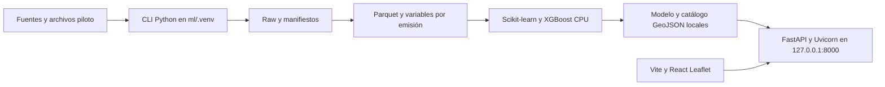
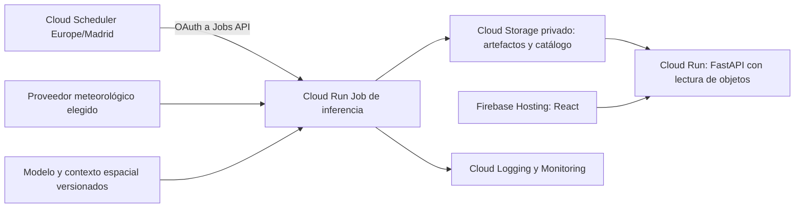

# Riesgo Galicia: tecnologías, ejecución local y despliegue futuro

Fecha: 2026-10-10. Rama: `feature/galicia-viirs-risk`.
Estado: diseño; no instala dependencias, crea recursos ni modifica configuración.
Complementa [FORECAST_VALIDATION_SUBPLAN.md](FORECAST_VALIDATION_SUBPLAN.md),
fases A–G. El contrato experimental y las decisiones D1–D7 siguen allí.
El procedimiento de producción existente permanece en [DEPLOYMENT.md](DEPLOYMENT.md).

Confirmado: reutilizar Google Cloud, condicionado a revisión de costes y
autorización directa del usuario antes de cualquier despliegue. La primera
publicación histórica puede funcionar sin automatización diaria.

## 1. Stack concreto y política de versiones

Versiones existentes leídas del repositorio, no una recomendación de actualizar
a la última versión. Las nuevas dependencias se resolverán y fijarán en un
entorno limpio antes de implementarlas, comprobando Windows y Linux; no se
declara compatible una combinación solo porque exista documentación.

| Capa | Tecnología | Uso y estado |
| --- | --- | --- |
| Runtime ML/backend | Python 3.13.11, `venv`, `pip` | Reutilizar runtime del proyecto; entornos separados `ml/.venv` y `backend/.venv`. |
| Tablas y almacenamiento | Pandas 3.0.5, PyArrow 25.0.1, Parquet con Zstandard | Ya fijados en ML; tablas locales y manifiestos JSON con SHA-256. |
| Geografía | H3 4.5.0, Shapely 2.2.0, PyProj 3.8.0 | Ya fijados. H3 r5 para predicción; distancias de focos calculadas en metros, no grados. |
| Cartografía MFE25/PRTR/EFFIS | GeoPandas + Pyogrio | Propuesta de nuevas dependencias para leer SHP/GML y operar capas. Usar Shapely/PyProj existentes para geometría; comprobar los drivers del archivo piloto antes de fijar versiones. |
| Tiempo/configuración/CLI | `zoneinfo`, `tomllib`, `argparse`, `pathlib`, `logging` | Biblioteca estándar; Europe/Madrid, configuración TOML, CLI por etapas y logs sin secretos. |
| Descargas ML | `urllib.request`, `csv`, `json` | Reutilizar patrón de los clientes FIRMS y meteorológico actuales con límites, timeout y reintentos acotados. No introducir otro cliente HTTP solo para el nuevo módulo. |
| Baseline y ML | Scikit-learn, XGBoost CPU | Nuevos: `Pipeline`, `SimpleImputer`, `StandardScaler`, `LogisticRegression`, `XGBClassifier`; sin GPU. Baseline estacional calculado con Pandas. |
| Evaluación | Scikit-learn metrics, Matplotlib; notebook Jupyter opcional | AP, Recall@Top10% diario, Brier y calibración; figuras exportables y tablas. El notebook consume funciones del paquete. |
| Modelo persistido | Joblib para pipeline propio; formato UBJSON/JSON nativo para XGBoost | Versionar transformación y modelo juntos. Cargar solo artefactos propios verificados; prueba de predicciones antes/después de serializar. |
| API | FastAPI 0.141.1, Uvicorn 0.52.4, Pydantic 2.13.5 | Mantener stack del backend; tipos de fecha y validación GeoJSON/metadata. No importar XGBoost o GeoPandas en las rutas públicas. |
| Frontend | Node 22.21.0, npm 10.9.4; React 19, Vite 8, React Leaflet 5, Leaflet 1.9 | Reutilizar `package-lock.json` con `npm ci`; componentes y hooks actuales, sin otra librería de mapas. |
| Pruebas | `unittest`/`unittest.mock`; Node test runner, Vitest, Testing Library, Playwright | Mantener herramientas existentes. No añadir Pytest solo por el plan inicial. |
| Empaquetado del job | Docker, imagen Python slim del runtime acordado | Solo necesario al preparar portabilidad/despliegue. Fijar tag y digest comprobados; no inventar el digest en el plan. |

GeoPandas documenta el uso de Pyogrio para lectura y escritura geoespacial.
La persistencia Scikit-learn requiere controlar entorno y procedencia; para
XGBoost usar su formato de modelo, no un volcado opaco como contrato portable.
Fuentes: [GeoPandas I/O](https://geopandas.org/en/stable/docs/user_guide/io.html),
[Scikit-learn persistence](https://scikit-learn.org/stable/model_persistence.html),
[XGBoost model I/O](https://xgboost.readthedocs.io/en/stable/tutorials/saving_model.html).

Para evitar que el job arrastre notebooks y cartografía cruda, preparar al llegar
a G un `ml/requirements-inference.in` y su lock: solo librerías usadas para clima,
transformaciones, modelo y publicación. Mantener compatibilidad exacta con los
artefactos entrenados. La división se verifica con una prueba real de inferencia,
no copiando a mano una lista incompleta de dependencias transitivas.

## 2. Arquitectura local: entrega principal



No se necesita una base de datos nueva para la demo. Los datasets y modelos
residen en `ml/data/` y `ml/artifacts/`, ya ignorados en Git. El API solo necesita
el catálogo y GeoJSON publicados localmente; puede servirlos con el equipo sin
acceso a fuentes externas una vez construida la muestra.

### L1 — Entornos y contrato, fases A/B

- [ ] Verificar Python y Node fijados; instalar los locks actuales en sus venv.
- [ ] Añadir GeoPandas/Pyogrio al abordar MFE25 y librerías ML al abordar E,
  no todas de golpe; guardar locks reproducibles y revisar sus cambios.
- [ ] Actualizar configuración: fecha local, corte de emisión, versiones de
  fuentes, radio candidato, máscara de celdas y referencias de particiones.
- [ ] Mantener `FIRMS_MAP_KEY` en entorno local; no copiar `backend/.env` al
  frontend, imágenes, datasets o manifiestos. El job diario no necesita FIRMS
  para producir predicciones si su pipeline no usa detecciones antecedentes.
- [ ] Extender la validación CI existente con pruebas ML acotadas cuando se
  implemente el contrato nuevo, sin secretos ni red. Las pruebas completas de
  release siguen `TESTING.md`; no se añade un workflow de despliegue automático.

Entrega: instalación limpia y configuración validada. La selección de proveedor
meteorológico sigue dependiendo del piloto, aunque el adaptador tenga nombre.

### L2 — Pipeline y experimentos, fases B–E

Interfaz CLI propuesta, todavía sin implementar, desde la raíz del repositorio:

```powershell
$env:PYTHONPATH = 'ml/src'
.\ml\.venv\Scripts\python.exe -m wildfire_risk.cli audit-sources --config ml/config/experiment.toml
.\ml\.venv\Scripts\python.exe -m wildfire_risk.cli build-dataset --config ml/config/experiment.toml
.\ml\.venv\Scripts\python.exe -m wildfire_risk.cli train --config ml/config/experiment.toml
.\ml\.venv\Scripts\python.exe -m wildfire_risk.cli evaluate --run-id <run_id>
.\ml\.venv\Scripts\python.exe -m wildfire_risk.cli export-demo --run-id <run_id>
```

Los comandos validan prerrequisitos: `evaluate` no abre el test final sin una
selección congelada; reanudar no sobrescribe artefactos incompatibles. Pruebas
automatizadas usan fixtures sintéticas; el piloto de fuentes es una ejecución
real separada y acotada. El dataset no hereda el antiguo periodo por defecto.

Entregas: matriz de fuentes, muestra completa, variantes auditadas, dataset
versionado, modelo/calibración, métricas, catálogo y GeoJSON. Criterios de cierre
detallados en F1–F6 y sección 8 del subplan experimental.

### L3 — Demo integrada, fase F

- [ ] Añadir `risk_repository.py` con lectura de archivos locales y validación
  de catálogo/hash; configuración propuesta `RISK_STORAGE_BACKEND=local` y
  `RISK_ARTIFACT_DIR` apuntando a una carpeta absoluta de artefactos.
- [ ] Implementar los contratos propuestos de riesgo y catálogo; mantener
  rate limit y cabeceras de seguridad existentes.
- [ ] Resolver explícitamente el proxy: hoy Vite elimina `/api`. Propuesta:
  regla específica para `/api/v1/risk` que preserve la ruta, antes de la regla
  general; cliente de riesgo con base local `/api/v1/risk` y base de producción
  construida desde el origen del API. Probar ambas resoluciones; no cambiar las
  rutas de incendios ni concatenar accidentalmente `/api/api`.
- [ ] Añadir fecha objetivo separada de `days`, capa GeoJSON, leyenda y selección
  en el explorador. Calidad/ausencia visibles y respuestas antiguas cancelables.

Arranque actual del backend desde `backend/`:

```powershell
.\.venv\Scripts\python.exe -m uvicorn main:app --reload --host 127.0.0.1 --port 8000
```

Arranque actual del frontend desde `frontend/`:

```powershell
npm ci
npm run dev
```

Entrega: demo histórica local navegable con un catálogo acotado y resultados
reproducibles. Verificar también que la capa de riesgo no dispara consultas
meteorológicas o entrenamiento desde el navegador.

### L4 — Ensayo operativo local, preparación de G

- [ ] Añadir `predict --target-date <fecha> --cutoff <instante> --output <ruta>`
  a la misma CLI; usar las transformaciones y modelo congelados.
- [ ] Simular la ejecución de medianoche con reloj inyectable: datos parciales,
  ejecución retrasada, caída del proveedor y repetición de la misma fecha.
- [ ] Si no hay evidencia de disponibilidad previa al corte, no atribuirla
  retrospectivamente a las 00:00; devolver falta de predicción o estado explícito.
- [ ] Construir y ejecutar localmente `ml/Dockerfile.inference` contra fixtures.
  Comparar el contenedor Linux con la ejecución Windows dentro de tolerancias
  documentadas; el API continúa arrancando sin librerías de entrenamiento.

No crear una tarea del Programador de Windows ni otra automatización persistente
solo para este ensayo. La hora lógica de emisión y la hora real de finalización
se guardan por separado; arrancar a medianoche no garantiza publicar a las 00:00.

## 3. Despliegue futuro: dos entregas independientes

### P1 — Publicar primero la demo histórica

Arquitectura confirmada: Firebase Hosting existente para frontend y Cloud Run
existente para API, conservando Buildpacks y `backend/Procfile`.
No requiere Job ni Scheduler. Almacenamiento de la primera demo pendiente de
respuesta: propuesta recomendada, catálogo pequeño incluido en el backend;
alternativa, bucket privado desde esta entrega.

Para el catálogo incluido: preparar una exportación explícita a
`backend/risk_artifacts/` antes del build, ignorada por Git pero incluida en el
contexto de despliegue tras revisar `.gcloudignore`. No esperar que `--source
backend` incluya `ml/artifacts/`, que queda fuera de ese contexto. Verificar tamaño
y hashes; modelos y datos crudos no forman parte del paquete del servidor.
Una actualización de fechas requiere otra publicación; esto encaja con una demo
histórica acotada y no añade almacenamiento externo.

Pasos:

1. Preparar exportación, pruebas de contrato, build y ficha de release local.
2. Ejecutar las verificaciones de release de `DEPLOYMENT.md` y `TESTING.md`;
   conservar CI existente, sin introducir despliegue automático en cada push.
3. Presentar al usuario commit, artefactos, destinos, cambios y coste estimado;
   pedir autorización directa antes de publicar backend o frontend.
4. Tras autorización específica: publicar primero API compatible, comprobarla,
   después frontend; validar fechas, App Check, mapa y explorador.
5. Si falla: volver a revisión previa de Cloud Run y release previo de Hosting;
   un error en riesgo no elimina las capas de observaciones existentes.

### P2 — Predicción diaria automática, solo después



| Componente | Propuesta concreta | Configuración por validar antes de crear |
| --- | --- | --- |
| Job | Cloud Run Job, imagen Docker en Artifact Registry | Un task y paralelismo 1; CPU/memoria/timeout según ensayo L4, sin GPU ni reentrenamiento diario. |
| Horario | Cloud Scheduler, cron `0 0 * * *`, zona `Europe/Madrid` | Corte lógico y reintentos idempotentes. Probar DST; no sustituir por una hora UTC fija todo el año. |
| Salidas | Cloud Storage privado, objetos inmutables y catálogo JSON | Reutilizar `google-cloud-storage==3.14.1`, ya resuelto en backend; declararlo directo al usarlo y resolverlo en el lock del job. Retención/lifecycle acordados; API con lectura y job con escritura limitada. |
| API | Backend Cloud Run actual, adaptador GCS de `risk_repository.py` | Configuración propuesta `RISK_STORAGE_BACKEND=gcs`, bucket/prefijo; mismo contrato HTTP que local. |
| Credenciales | Cuentas de servicio + ADC; Secret Manager si el proveedor exige clave | Scheduler solo invoca el job; job accede a sus entradas/salidas; API solo lee predicciones. Sin archivos de claves en la imagen. |
| Telemetría | Logs JSON en stdout, Cloud Logging y Monitoring | Fecha objetivo, run/modelo, duración, cobertura, estado y motivo de fallo; alertar por falta de salida, no solo por error del proceso. |
| Publicación | Builds y releases manuales con `gcloud` y Firebase CLI | Scripts revisables, sin Terraform ni CD automático necesario para esta primera versión. |

Propuesta de bundle de inferencia: incluir en la imagen el modelo, calibrador,
lista ordenada de variables, malla y contexto espacial congelados, con hashes.
La imagen se identifica por digest; cambiar el modelo exige otra release.
El job descarga solo las entradas meteorológicas necesarias y publica salidas;
no recalcula MFE25, PRTR ni el estudio completo de focos cada medianoche.
La invocación de Jobs usa OAuth hacia la API de Google; es distinta del OIDC
usado hoy en `/internal/ingest`. Scheduler permite elegir zona horaria y requiere
tratar anomalías horarias. Fuentes: [Jobs programados](https://docs.cloud.google.com/run/docs/execute/jobs-on-schedule),
[zona horaria de Scheduler](https://docs.cloud.google.com/scheduler/docs/configuring/cron-job-schedules).

Publicación propuesta: escribir objeto de predicción inmutable, comprobar hash
y esquema, y después actualizar catálogo con precondición de generación. Usar
creación condicional para impedir duplicados; tratar conflictos como relectura
y comparación, no sobrescritura ciega. Identidad: fecha objetivo + corte + versión
de modelo/variables. Referencia: [precondiciones de Cloud Storage](https://cloud.google.com/storage/docs/request-preconditions).

Antes de GCS, el almacenamiento local implementa el mismo comportamiento mediante
temporales y reemplazo de archivo. No se necesita un emulador cloud para probar
la lógica; simular el adaptador y comprobar errores de generación en tests.

### P3 — Secuencia de activación autorizada

- [ ] Inspeccionar configuración real y cuotas de los recursos existentes;
  `europe-west1` aparece en la URL/configuración del API, no prueba el estado
  actual de toda la infraestructura ni la disponibilidad del presupuesto.
- [ ] Acordar región de job/bucket, retención, presupuesto y límites de ejecución.
- [ ] Preparar Dockerfile, locks, scripts, IAM mínimo, configuración y rollback;
  publicar una propuesta revisable antes de pedir autorización.
- [ ] Tras aprobación del alcance concreto: crear lo necesario, publicar imagen
  y artefactos iniciales, ejecutar manualmente el job y comprobar lectura API.
- [ ] Activar Scheduler solo tras validar esa ejecución y con autorización;
  comprobar publicación, reejecución, caída meteorológica y alerta de salida ausente.
- [ ] Rollback: pausar Scheduler, fijar catálogo/modelo anterior y volver a
  revisión API/frontend si procede. Mantener la fecha real del último resultado;
  no etiquetar una predicción de ayer como si fuera la de hoy.

## 4. Coste y decisión de región

Prioridad del usuario: servicios gratuitos siempre que haya alternativa viable.
P1 reduce recursos nuevos. P2 puede consumir franquicias gratuitas, pero requiere
revisar facturación, uso compartido de la cuenta y tráfico; no se promete coste cero.

La franquicia de Cloud Storage consultada se limita a determinadas regiones de
EE. UU.; no asumir que un bucket en `europe-west1` queda cubierto. Comparar junto
al usuario almacenamiento cercano al API frente a una región elegible, incluyendo
tráfico entre regiones y latencia. Un presupuesto de alertas por sí solo no corta
el gasto; comprobar si existen límites de gasto aplicables a cada servicio.
Fuentes: [Free Tier](https://docs.cloud.google.com/free/docs/free-cloud-features),
[presupuestos y alertas](https://docs.cloud.google.com/billing/docs/how-to/budgets).

Antes de aprobar P2, medir y presentar una tabla con: ejecuciones y reintentos al
mes × CPU/memoria/tiempo, tamaño y retención de objetos, operaciones Storage,
lecturas API, tráfico, builds, imágenes, secretos y logs. Comparar P1 y P2 usando
consumo observado en L4 y precios vigentes, no estimaciones de «gratis» sin datos.
Referencias: [Cloud Run](https://cloud.google.com/run/pricing),
[Scheduler](https://cloud.google.com/scheduler/pricing),
[Firebase Hosting](https://firebase.google.com/docs/hosting/usage-quotas-pricing).

## 5. Orden del trabajo y definición de terminado

1. A–E/L1–L2: resolver fuentes y conseguir modelo/evaluación reproducibles.
2. F/L3: entregar demo íntegramente local y verificable.
3. Preparar P1; preguntar directamente antes de publicar la demo.
4. G/L4: ensayo de inferencia, contenedor y costes. Puede prepararse localmente
   aunque el usuario prefiera posponer P1.
5. Preparar P2/P3; preguntar directamente antes de cada activación o escritura
   cloud comprendida en el alcance pendiente. Aprobar el plan no autoriza desplegar.

Terminado local: instalación reproducible, muestra y experimentos trazables,
GeoJSON verificado, API/UI funcionales y pruebas relevantes aprobadas.
Terminado futuro: además, ejecución diaria y recuperación verificadas, coste
aceptado y autorización ejecutada solo para los recursos acordados.

Pendiente de decisión con evidencia: proveedor/años, parámetros forestales,
regla de creación de centros, mes parcial en recurrencia, cobertura meteorológica
mínima, empaquetado de P1, región/retención/coste de P2. Las versiones nuevas se
fijarán tras comprobar compatibilidad; esta revisión no modifica los locks.
